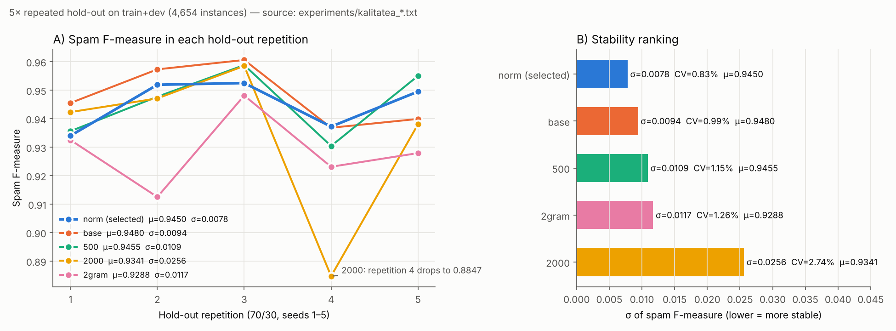
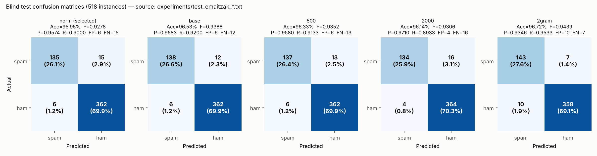
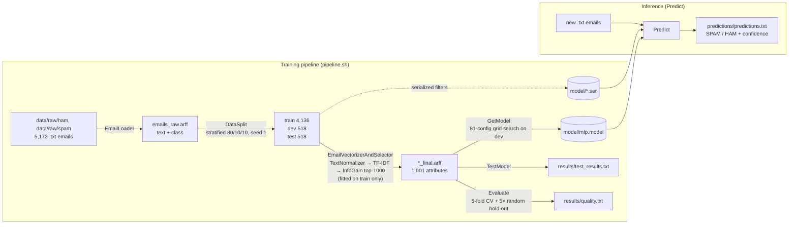

# Spam/Ham Email Classifier — Java & Weka (TF-IDF + Multilayer Perceptron)

A command-line pipeline in Java and Weka that turns raw email text into TF-IDF features and classifies messages as **spam** or **ham** with a tuned Multilayer Perceptron. It was trained on 5,172 emails of the Enron-Spam corpus and reaches **95.95 % accuracy on a held-out blind test set** (518 emails) using the model shipped in the repository.

---

## Results at a glance

All figures come from the result files in [`experiments/`](experiments/) for the selected configuration (`norm` = TextNormalizer + TF-IDF + InfoGain top-1000 + MLP, learning rate 0.01, momentum 0.1, 3 hidden neurons, 500 epochs).

| Evaluation | Data | Accuracy | Spam precision | Spam recall | Spam F1 | Weighted F1 |
|---|---|---|---|---|---|---|
| Blind test (`TestModel`) | test split, 518 emails never used for training or tuning | 95.95 % | 0.9574 | 0.9000 | 0.9278 | 0.9591 |
| 5-fold cross-validation (`Evaluate`) | train + dev, 4,654 emails | 96.61 % | 0.9408 | 0.9422 | 0.9415 | 0.9661 |
| 5× repeated random 70/30 hold-out (`Evaluate`), mean ± σ | train + dev, 4,654 emails | – | 0.9286 ± 0.0160 | 0.9623 ± 0.0084 | 0.9450 ± 0.0078 | 0.9678 ± 0.0039 |

Blind-test confusion matrix: 135 of 150 spam emails detected (15 missed). 6 of 368 legitimate emails flagged as spam.

> **Why this configuration?** Five feature configurations were compared. `norm` was chosen because its hold-out results vary the least: it has the lowest σ for spam F1, spam recall, ham precision, ham F1 and weighted F1 (5 of the 7 hold-out metrics). It is **not** the best on every single score: on the blind test, `2gram` reached 96.72 % accuracy and a spam F1 of 0.9439. Full comparison: [docs/DESIGN.md §7](docs/DESIGN.md#7-estimated-quality).

---

## Technical highlights

- **No data leakage between splits.** The TF-IDF vocabulary (`StringToWordVector.setInputFormat(train)`) and the InfoGain ranking (`AttributeSelection.setInputFormat(trainVec)`) are learned **on the training split only**. The same fitted filters are then applied to dev, test and new emails.
- **Train/inference parity.** The three fitted filters are serialized (`model/normalizer.ser`, `vectorizer.ser`, `selector.ser`) and reloaded by `Predict`. New emails therefore go through exactly the same transformation as the training data.
- **Custom Weka filter.** `TextNormalizer` extends `SimpleStreamFilter` and applies 7 regex steps before vectorization: URLs → `URLTOKEN`, email addresses → `EMAILTOKEN`, spaced-out letters joined (`h e l l o` → `hello`), `name=value` HTML attributes removed, runs of 2+ HTML tag names removed (e.g. `trtd`), repeated punctuation collapsed (`!!!` → `!`), and whitespace normalized.
- **Dimensionality reduction.** Words are stemmed (Lovins), stopwords are removed (Rainbow list), and up to 25,000 words per class are kept with TF and IDF weighting. InfoGain then keeps the top **1,000** attributes (1,001 with the class). The report states 33,863 attributes before selection.
- **Systematic hyperparameter search.** `GetModel` trains **81 MLPs**: learning rate {0.003, 0.005, 0.01} × momentum {0.1, 0.2, 0.3} × hidden neurons {3, 5, 10} × epochs {200, 300, 500}. Each one is scored by spam F1 on the dev split, and its training time is logged. One full grid took about 82 minutes for the selected configuration.
- **Ablation study.** Seven feature configurations were evaluated with the same protocol (fine-tuning, blind test, CV, repeated hold-out): baseline, +normalizer, bigrams, 500 / 2,000 attributes, normalizer+bigrams and normalizer+InfoGain threshold. All the result files are kept in `experiments/`.
- **Experiment tracking.** `ExperimentLogger` appends to `experiment_log.txt`, for every step: a timestamp, the OS, the Java version, the CPU and core count, the used memory, the parameters and the results. The archived log has 371 entries, written in Basque.
- **Measured limitation.** On 12 new emails written in three languages, the classifier got English 4/4 right, Spanish 1/4 and Basque 3/4. It is reliable only for English, the language it was trained on ([details](docs/DESIGN.md#83-functional-limitation-of-the-model-language-dependence)).

### Model comparison

| Configuration | Blind-test accuracy | Blind-test spam F1 | 5-fold CV spam F1 | Hold-out spam F1 (μ ± σ) |
|---|---|---|---|---|
| base (1,000 attributes) | 96.53 % | 0.9388 | 0.9454 | 0.9480 ± 0.0094 |
| **norm (selected)** | 95.95 % | 0.9278 | 0.9415 | **0.9450 ± 0.0078** |
| 500 attributes | 96.33 % | 0.9352 | 0.9387 | 0.9455 ± 0.0109 |
| 2,000 attributes | 96.14 % | 0.9306 | 0.9489 | 0.9341 ± 0.0256 |
| 2gram | 96.72 % | 0.9439 | 0.9359 | 0.9288 ± 0.0117 |





---

## Architecture



Every training step also appends an entry to `experiment_log.txt` through `ExperimentLogger`.

The class diagram and a description of each component are in [docs/DESIGN.md §9](docs/DESIGN.md#9-design).

### Representative code: fitting on train only

From [`src/EmailVectorizerAndSelector.java`](src/EmailVectorizerAndSelector.java):

```java
stwv.setStemmer(new LovinsStemmer());
stwv.setStopwordsHandler(new Rainbow());
stwv.setInputFormat(train);                       // vocabulary learned from train only

Instances trainVec = Filter.useFilter(train, stwv);
Instances devVec   = Filter.useFilter(dev, stwv); // same vocabulary applied to dev/test
Instances testVec  = Filter.useFilter(test, stwv);

filterSelector.setEvaluator(new InfoGainAttributeEval());
filterSelector.setSearch(search);                 // Ranker, numToSelect = 1000
filterSelector.setInputFormat(trainVec);          // ranking learned from train only

// saved so that Predict applies exactly the same transformation to new emails
FilterSerializationHelper.saveFilter(stwv, "model/vectorizer.ser");
FilterSerializationHelper.saveFilter(filterSelector, "model/selector.ser");
```

---

## How to run

**Requirements:** Java 11 or newer (a JDK if you want to compile). Weka 3.8.6 is included as `lib/weka.jar`. The commands use the Linux/macOS classpath separator `:`. In Windows PowerShell or CMD, use `;` instead (`-cp "lib/weka.jar;bin"`). `-Dfile.encoding=UTF-8` makes Weka read and write the ARFF files as UTF-8 on every operating system. `--add-opens` only silences a reflection warning that Weka prints on Java 9+.

### 1. Classify emails with the trained model (seconds)

`bin/` already contains the compiled classes.

```bash
java -Dfile.encoding=UTF-8 --add-opens java.base/java.lang=ALL-UNNAMED -cp "lib/weka.jar:bin" \
     Predict model/mlp.model data/samples/ predictions/
```

`Predict` reads every `.txt` file under the input folder, including subfolders. Expected output (`predictions/predictions.txt`; the files are read in path order, `eng_ham_1.txt` … `eus_spam_2.txt`):

```text
==================================================
               PREDICTIONS - RESULTS
==================================================

1. email: HAM (confidence: 0.9993)
2. email: HAM (confidence: 0.9986)
3. email: SPAM (confidence: 0.9268)
4. email: SPAM (confidence: 0.9938)
...
12. email: HAM (confidence: 0.5998)

==================================================
Total classified emails: 12
==================================================
```

"Confidence" is the probability the MLP gives to the predicted class.

### 2. Reproduce the blind test (seconds)

```bash
java -Dfile.encoding=UTF-8 --add-opens java.base/java.lang=ALL-UNNAMED -cp "lib/weka.jar:bin" \
     TestModel data/splits/test_final.arff model/mlp.model results/test_results.txt
```

This writes the metrics to `results/test_results.txt` and one line per email to `results/test_results_predictions.txt`.

### 3. Run the full pipeline (about 1.5 h on the hardware used for the experiments, mostly the 81-model grid search)

```bash
chmod +x pipeline.sh
./pipeline.sh      # Bash: Linux, macOS or Git Bash
```

The pipeline compiles the code, rebuilds the corpus and the splits, fits the filters, runs the grid search, the blind test, the quality estimation and the predictions, and regenerates the Javadoc in `docs/javadoc/`. It overwrites `model/` and `data/splits/`.

> **Reproducibility.** `EmailLoader` builds the same ARFF on every operating system: it reads the emails as UTF-8, sorts the labels and the files by name, and `.gitattributes` stops Git from converting the data to CRLF. This was checked byte by byte on two machines with Java 11 and Java 21. The shipped `data/splits/` and `model/` come from the original run of the course project, where the e-mail order depended on the file system of that computer. A new run therefore contains the same 5,172 emails but produces a different (reproducible) split, so its scores will differ slightly from the ones above.

---

## Repository structure

```text
.
├── .vscode/              # VS Code setting that adds lib/*.jar to the classpath
├── .gitattributes        # Keeps data/ byte-identical on every OS (no CRLF conversion)
├── bin/                  # Compiled classes (Java 11 bytecode)
├── data/
│   ├── raw/              # Enron-Spam corpus: ham/ (3,672) and spam/ (1,500) .txt files + emails_raw.arff
│   ├── samples/          # 12 new test emails (English, Spanish, Basque)
│   └── splits/           # train/dev/test ARFF files, raw and vectorized (*_final.arff)
├── docs/
│   ├── DESIGN.md         # English translation of the project report, checked against the code
│   ├── images/           # Charts of the report, redrawn in English from the result files
│   ├── javadoc/          # Generated API documentation (English)
│   └── original-eu/      # Original report in Basque: doku.tex, "Graficos varios.txt"
│       └── diagramak/    # Original diagrams and charts (Basque labels)
├── experiments/          # Result files of the 7 configurations of the ablation study (original Basque output)
├── lib/                  # weka.jar (Weka 3.8.6)
├── model/                # Trained MLP (mlp.model) and serialized filters (*.ser)
├── predictions/          # Output of Predict on data/samples/ (predictions.txt + intermediate ARFF files)
├── results/              # Default output folder of the programs
│   └── archive/          # Earlier exploratory runs (original Basque output)
│       └── iragarpenak/  # Output of the original Iragarri program on the sample emails
├── src/                  # Java sources
│   ├── EmailLoader.java                 # .txt folders → ARFF (TextDirectoryLoader)
│   ├── DataSplit.java                   # Stratified 80/10/10 split
│   ├── TextNormalizer.java              # Custom regex Weka filter
│   ├── EmailVectorizerAndSelector.java  # TF-IDF + InfoGain, saves the filters
│   ├── FilterSerializationHelper.java   # Save/load Weka filters
│   ├── GetModel.java                    # MLP grid search, saves the best model
│   ├── TestModel.java                   # Blind test evaluation
│   ├── Evaluate.java                    # 5-fold CV + repeated hold-out
│   ├── ExperimentLogger.java            # Experiment tracking log
│   └── Predict.java                     # Inference on new emails
├── CHANGELOG.md
├── experiment_log.txt    # Experiment log (earlier entries in Basque)
├── pipeline.sh           # End-to-end pipeline
└── README.md
```

Files produced before the translation (in `experiments/`, `results/archive/` and the older entries of `experiment_log.txt`) were kept as they are, in Basque. A glossary of their words is in [docs/DESIGN.md, Appendix B](docs/DESIGN.md#appendix-b--glossary-of-the-original-result-files).

---

## Skills demonstrated

- **Machine learning:** text classification, TF-IDF feature engineering, attribute selection with Information Gain, neural networks (MLP), hyperparameter grid search, handling class imbalance by choosing the spam-class F1 as the metric.
- **Evaluation methodology:** train/dev/test separation, a leakage-free filter fit, k-fold cross-validation, repeated hold-out with mean ± standard deviation, model selection that weighs score against stability, error analysis with confusion matrices.
- **Software engineering in Java:** a modular command-line pipeline (10 classes), extending the Weka API with a custom filter, object serialization for train/inference parity, experiment logging, Javadoc, Bash automation.
- **Data and NLP preprocessing:** regex text normalization, tokenization, stemming, stopword removal, ARFF data handling.
- **Teamwork and documentation:** a three-person project with a written technical report, class and data-flow diagrams.

---

## Authors and academic context

Course project for **Decision Support Systems** (*Erabakiak Hartzeko Euskarri Sistemak*), 3rd year, 2nd semester. Bachelor's Degree in Management and Information Systems Engineering, **Bilbao School of Engineering (UPV/EHU)**. The original report is written in Basque.

| Author | Main responsibility (from the project report) |
|---|---|
| **Andoni Ortiz de Zarate** | MLP development and grid-search tuning; experiment tracking (`ExperimentLogger`); analysis of the metrics and their charts; initial data loading and model testing |
| **Gorka Piedra** | Javadoc documentation; data split (`DataSplit`); model training and saving (`GetModel`); model evaluation (`Evaluate`); error handling and report editing |
| **Ibai Olaziregi** | Vectorization and attribute selection (`EmailVectorizerAndSelector`); inference (`Predict`, originally `Iragarri`); text normalization (`TextNormalizer`); class diagram and final refactoring |

The report states that all three members took part in every part of the project. The table shows who carried the main load of each part.

Dataset: the Enron-Spam corpus (Metsis, Androutsopoulos & Paliouras, 2006). This repository contains the subset with 3,672 ham (`farmer` mailbox) and 1,500 spam emails.
