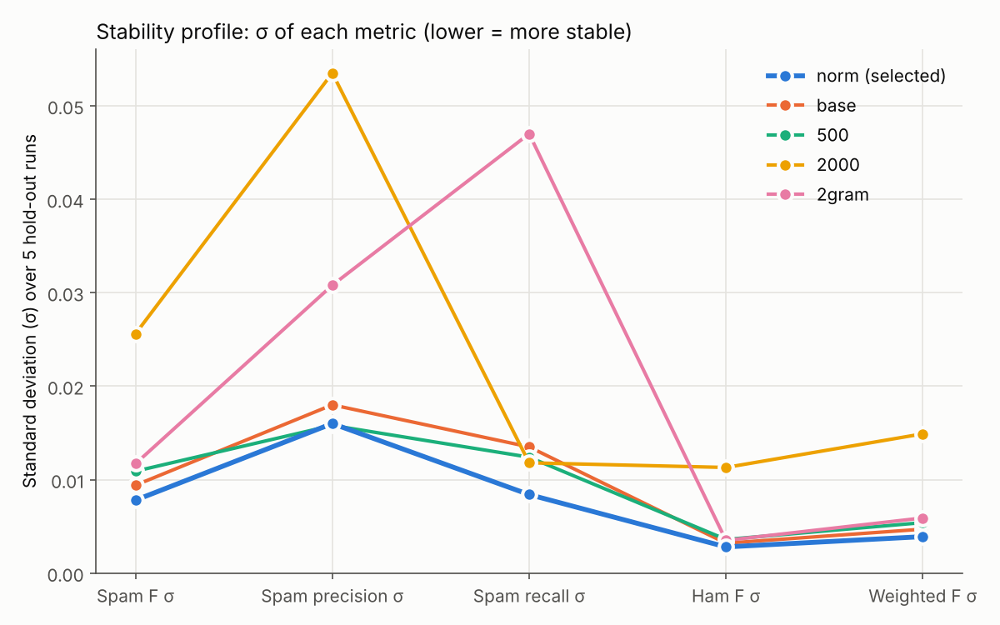
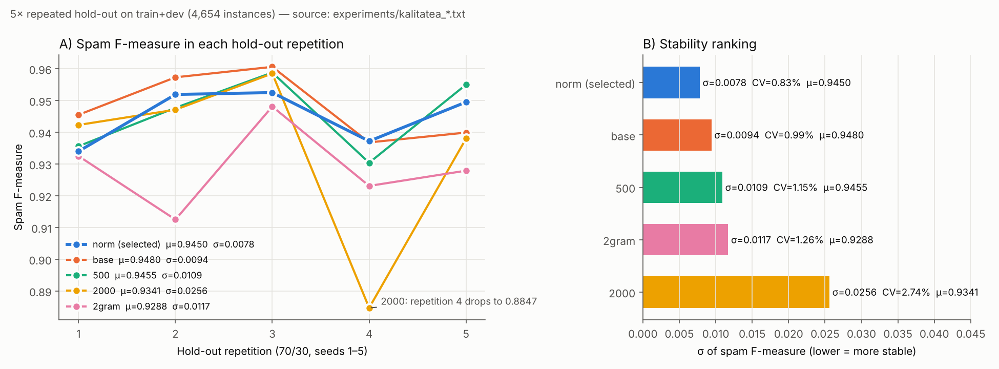
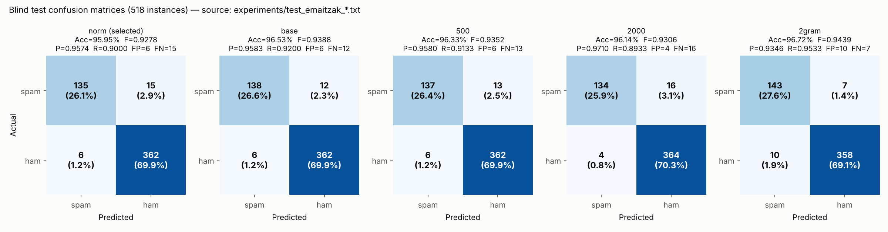
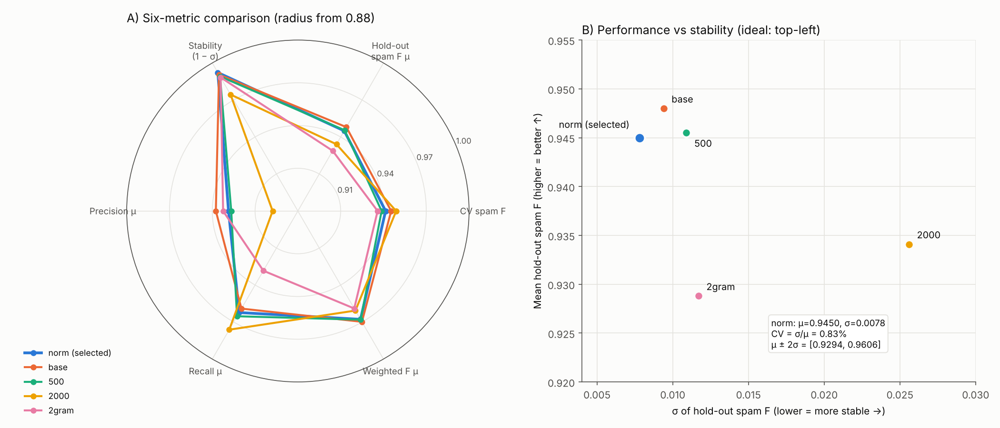
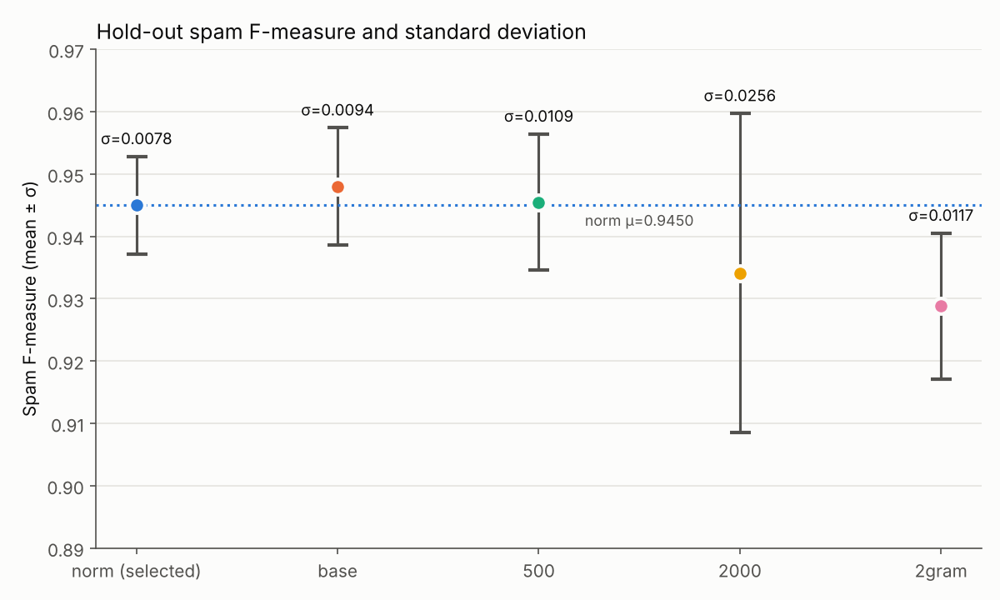
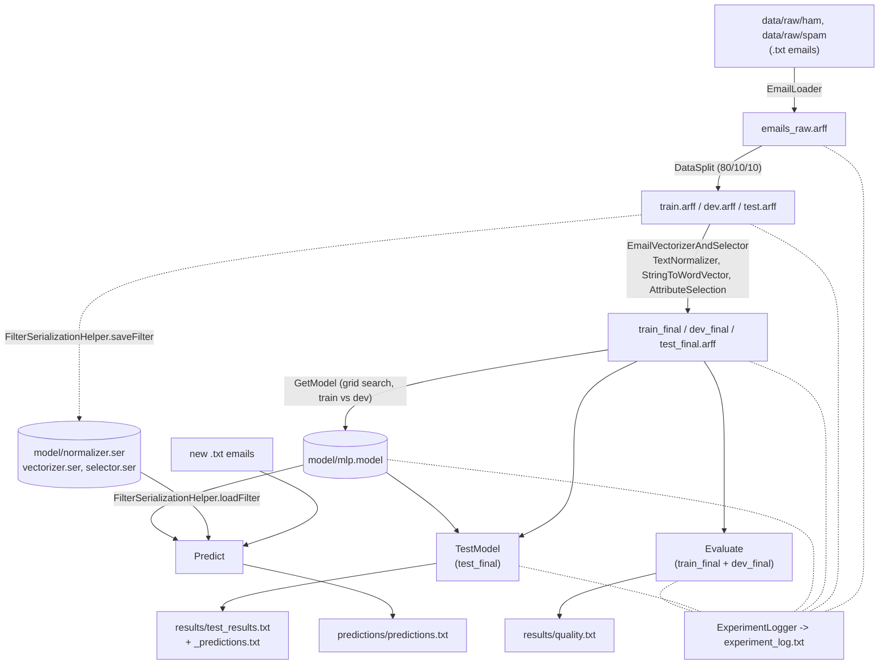
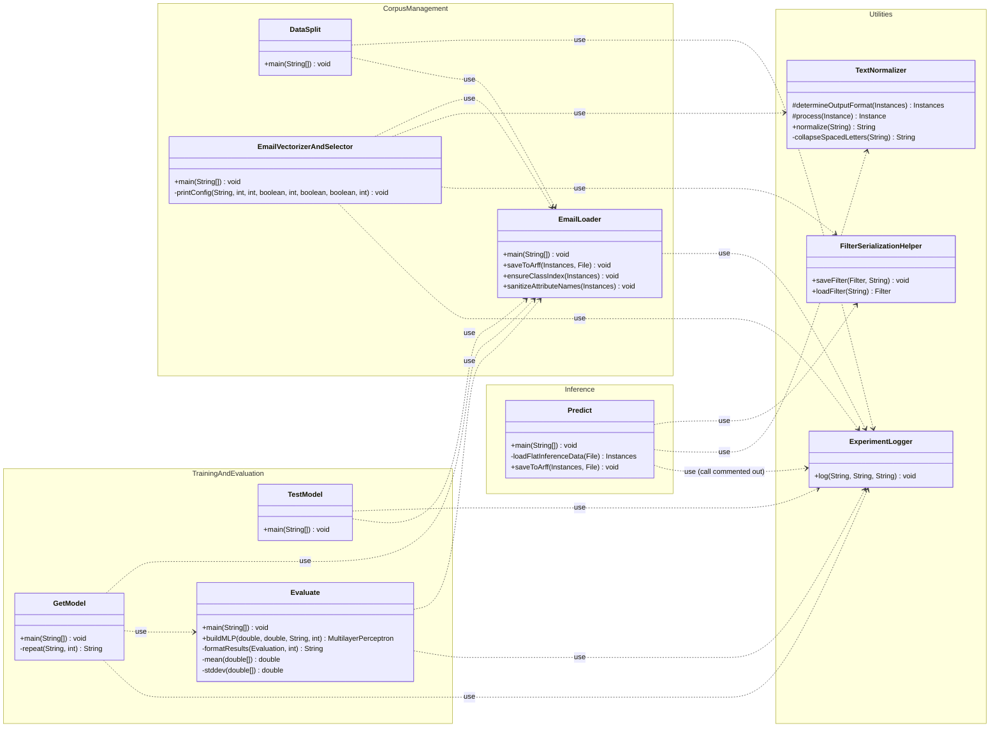

# Spam Classifier — Multilayer Perceptron

**Design document: English translation of the project report**

| | |
|---|---|
| School | Bilbao School of Engineering (*Bilboko Ingeniaritza Eskola*), UPV/EHU |
| Degree | Bachelor's Degree in Management and Information Systems Engineering |
| Course | Decision Support Systems (*Erabakiak Hartzeko Euskarri Sistemak*), 3rd year, 2nd semester |
| Authors | Gorka Piedra, Andoni Ortiz de Zarate, Ibai Olaziregi |
| Original | [`docs/original-eu/doku.tex`](original-eu/doku.tex) (Basque, LaTeX) |

**About this translation.** The text below is a faithful translation of the original report. Its tables, calculations and diagrams are kept. The report was then **checked against the source code and the result files** in the repository. Wherever they disagree, the original statement is kept and is followed by a box like this one:

> **Review note.** What the code or the data actually shows.

File and class names follow the English names used in the repository today (for example `Predict` instead of `Iragarri`, `model/` instead of `modelo/`). [Appendix A](#appendix-a--name-equivalence-table) maps every original name to its new name.

---

## Contents

1. [Distribution of team responsibilities](#1-distribution-of-team-responsibilities)
2. [Dataset analysis](#2-dataset-analysis)
3. [Preprocessing](#3-preprocessing)
4. [Vectorization](#4-vectorization)
5. [Classifier: Multilayer Perceptron](#5-classifier-multilayer-perceptron)
6. [Parameter optimization: fine-tuning](#6-parameter-optimization-fine-tuning)
7. [Estimated quality](#7-estimated-quality)
8. [User package](#8-user-package)
9. [Design](#9-design)
10. [Use of Artificial Intelligence](#10-use-of-artificial-intelligence)
- [Bibliography](#bibliography)
- [Appendix A — Name equivalence table](#appendix-a--name-equivalence-table)
- [Appendix B — Glossary of the original result files](#appendix-b--glossary-of-the-original-result-files)
- [Appendix C — Summary of the review against the code](#appendix-c--summary-of-the-review-against-the-code)

---

## 1. Distribution of team responsibilities

*Table 1. Responsibility of each team member and the parts they implemented.*

| Member | Main responsibility | Implemented parts |
|---|---|---|
| Gorka Piedra | Technical documentation, quality evaluation and data preparation. | • Creation of the Javadoc documentation in several classes of the project.<br>• Implementation of the data split logic (`DataSplit`).<br>• `GetModel.java` logic to obtain and save the trained model.<br>• `Evaluate.java` implementation to evaluate the model.<br>• Error handling and refinement of the `doku.tex` documentation. |
| Andoni Ortiz de Zarate | Experimentation infrastructure and analysis, training and model persistence. | • Development and tuning of the MLP (*Multilayer Perceptron*) with *grid search*.<br>• Management of the experiment log in the `ExperimentLogger.java` files.<br>• Analysis of the metrics obtained and their representation in charts.<br>• Initial data loading and model testing. |
| Ibai Olaziregi | Text preprocessing, prediction interface and code cleaning. | • Development of `EmailVectorizerAndSelector.java` for vectorization and attribute selection.<br>• Implementation of `Iragarri.java` (now `Predict.java`) to predict new messages.<br>• Treatment of special characters and normalization in the `TextNormalizer.java` file.<br>• Design of the class diagram and final organization of the project (refactoring and cleaning). |

All team members took part, to a greater or lesser extent, in every part of the project (for example documentation, code cleaning and testing). Even so, the table shows the member who carried the most weight or workload in each part, to identify the main responsibilities more clearly.

---

## 2. Dataset analysis

### 2.1 Raw data

The dataset used is the Enron-Spam corpus. It is made of emails split into two classes: **spam** (unwanted) and **ham** (legitimate).

Spam messages are about commercial promotions, scams and premium services, and use persuasive language, capital letters, an urgent style and links (e.g. *"Free prize! Call now to claim your £1000"*).

Ham messages are everyday personal communications, with informal language, abbreviations and emoticons (e.g. *"Hey, what are you doing?"*).

> **Review note.** The repository contains the Enron-Spam subset with 3,672 ham emails from the `farmer` mailbox (1999–2001) and 1,500 spam emails (`GP` source, 2003–2005). The ham emails are corporate business email (gas-trading nominations, meters, deals). They are not informal SMS-style chat, and the two examples quoted above are not from this corpus.

*Table 2. Quantitative description of the original dataset (raw data).*

| Feature | Train | Dev | Test |
|---|---:|---:|---:|
| Nominal attributes | 1 | 1 | 1 |
| Numeric attributes | 0 | 0 | 0 |
| String attributes | 1 | 1 | 1 |
| Total attributes | 2 | 2 | 2 |
| Instances (spam ⊕) | 1,200 | 150 | 150 |
| Instances (ham ⊖) | 2,937 | 368 | 367 |
| Total instances | 4,137 | 518 | 517 |

As Table 2 shows, there is a clear imbalance between the classes: spam instances are only 29 % of the ham instances. This affects the performance of the model, especially the recall of the spam class.

> **Review note.** The ARFF files produced by `DataSplit` (`data/splits/`) contain **train 4,136 (1,200 spam / 2,936 ham), dev 518 (150 / 368) and test 518 (150 / 368)**, 5,172 in total. This matches the blind-test confusion matrix (135 + 15 + 6 + 362 = 518) and the 4,654 instances of train + dev used in §7. Spam is 29 % **of all emails** (1,500 / 5,172); it is 41 % of the number of ham emails.

### 2.2 Stratified split

`DataSplit.java` splits the dataset into three subsets with the `StratifiedRemoveFolds` method, keeping the class proportion in all the subsets. The split is **80 % / 10 % / 10 %**:

- **Train (80 %):** 4,137 instances — to train the model
- **Dev (10 %):** 518 instances — to optimize the parameters
- **Test (10 %):** 517 instances — to make the final predictions

> **Review note.** The code first shuffles the data (`Randomize`, seed 1) and takes fold 1 of 10 as test. It then takes fold 1 of 9 of the rest as dev and keeps the other 8 folds as train (all with seed 1). The real sizes are 4,136 / 518 / 518 (see the note above).

---

## 3. Preprocessing

Before a classification model is trained, the raw data (string format) must be cleaned and standardized. Emails (especially spam) usually contain a lot of noise: HTML tags, links, special characters and words with no semantic information. This section explains the cleaning processes applied, their goal and their quantitative effect on the data.

### 3.1 `TextNormalizer.java`: custom filter

For preprocessing the raw data we used our own `TextNormalizer.java` class to apply a text normalization phase. This filter is based on Weka's `SimpleStreamFilter` class and runs before the `StringToWordVector` vectorization.

The main goal is to reduce the noise of the text so that the model focuses on the important information. To do this, several changes based on regular expressions are applied, making it easier to generalize patterns and avoiding overfitting.

The transformations applied are:

1. **URL normalization:** URL structures are identified (for example `http://...` or `https://...`) and replaced by the single token `URLTOKEN`. In this way specific links are not distinguished, but the presence of a URL, which is usually indicative of spam, is kept.
2. **Email address normalization:** all email addresses are turned into the `EMAILTOKEN` token. This prevents the model from adapting to specific addresses and keeps the communication pattern.
3. **Joining spaced-out letters:** spam techniques often write words with separated letters (e.g. `"h e l l o"`). In these cases the letters are joined into a standard form such as `"hello"`.
4. **Removal of HTML attributes:** HTML attributes such as `href=`, `src=` and similar are removed from the text, because they carry little semantic information and create noise.
5. **Removal of HTML fragments:** the names of HTML tags or fragments (e.g. `div`, `span`, `br`, `img`) are removed, because they are mostly structural leftovers that appear in spam messages.
6. **Simplification of repeated punctuation:** repeated punctuation made of the same symbol (e.g. `"!!!"`) is simplified (`"!"`). In this way the emphasis is kept but the number of variants is reduced.
7. **Normalization of multiple spaces:** when more than one space appears in a row, it is reduced to a single space. Leading and trailing spaces are also removed.

Thanks to these changes, the text is simplified while keeping its informative structure, which improves the quality of the vectorization.

> **Review note (steps 4 and 5).** As implemented:
> - Step 4 removes tokens of the form `name=value` (`\b[a-z]+=[a-zA-Z0-9#]+\b`), e.g. `width=100`.
> - Step 5 removes only **runs of two or more** tag names written together (`(tr|td|br|…){2,}`, e.g. `trtd`, `brbr`). A single `div`, `span` or `nbsp`, and the `<` `>` characters, are **not** removed.
> - Step 3 only joins lowercase letters, and only when at least 4 of them are separated by spaces or dots.

**Example.** A simple example of the normalization:

- **Original text:** `"CLICK HERE!!! http://spam.com h e l l o user123@ikasle.ehu.eus <div>Oferta!!!</div>"`
- **Normalized text:** `"CLICK HERE! URLTOKEN hello EMAILTOKEN Oferta!"`

> **Review note.** Running `TextNormalizer.normalize()` on that input gives
> `"CLICK HERE! URLTOKEN hello EMAILTOKEN <div>Oferta!</div>"`. The `<div>` tags remain, as explained in the previous note.

### 3.2 Language processing (NLP)

After the text is cleaned, some linguistic transformations are applied to standardize the words. They are applied during the vectorization process:

- **Lowercasing:** upper and lower case are unified (so that *"FREE"* and *"free"* are treated as the same token). This avoids scattering the model.
- **Stopword filter (`Rainbow`):** words with no meaningful semantic information are removed (articles, prepositions, e.g. *"the"*, *"is"*). This reduces the noise.
- **Stemming (`LovinsStemmer`):** words are reduced to their lexical root (e.g. *"running"* and *"runs"* → *"run"*).

### 3.3 Quantitative justification of the experimental decisions

The previous NLP techniques (especially stopwords and stemming) were not chosen at random. Instead of evaluating each filter one by one, the combined effect of the **whole preprocessing block** (normalization + NLP) was measured, to see its real impact on the dimensionality and quality of the model.

One of the main problems of classifying free text is high dimensionality. The next table shows the size of the initial dataset without NLP cleaning, and the result after our whole process (stemmer, stopwords and attribute selection included):

*Table 3. Quantitative effect of the preprocessing techniques on dimensionality and performance.*

| Configuration | Number of attributes | Spam F-Measure (μ ± σ) |
|---|---|---|
| Without cleaning (raw text) | 33,863 + class | Computationally too heavy |
| **Full NLP pipeline** | **1,000 + class** | **0.9450 (± 0.0078)** |

According to the data, cleaning and the NLP filters (stemmer and stopwords) **reduce the dimensionality by 97 %** (from 33,863 attributes to 1,000) while guaranteeing **excellent model quality and stability** (spam F-Measure 0.9450, σ = 0.0078). This reduction proves that the thousands of removed words were nothing but noise. Because of these quantitative results, this process was included in the final model.

> **Review note.**
> - The arithmetic is correct: 1 − 1,000 / 33,863 = 97.0 %.
> - The 33,863 figure is not stored in any result file or log in the repository. `EmailVectorizerAndSelector` prints this count at runtime, after stemming and stopword removal but **before** InfoGain selection. Before fix C10, re-running it on a Windows checkout of the data gave 33,957: Git had converted the emails to CRLF line endings, which changes the tokens (see [Appendix C](#appendix-c--summary-of-the-review-against-the-code)).
> - No experiment without stemming/stopwords (or with a classifier on the raw text) is stored, so "computationally too heavy" is not backed by a measurement.
> - Most of the reduction comes from InfoGain keeping the top 1,000 attributes. Saying that the removed words "were nothing but noise" is an interpretation, not something measured.

---

## 4. Vectorization

### 4.1 Different vectorization methods

Four vectorization methods were studied on the train set, together with the MLP classifier, to choose the most suitable one. Evaluation schemes: **5-fold CV** and **Repeated Hold-Out**. Metric: **F-Measure (spam)**.

In the first experiments, the TF-IDF method obtained **F-spam = 0.9415** (5-fold CV) and **0.9450 ± 0.0078** (Repeated Hold-Out) with our configuration. However, we had problems with the parametrization of the StringToWordVector filter, which made it difficult to measure the experimental differences between the methods.

According to the literature, the expected behaviour of these methods is the following:

*Table 4. Theoretical features of the vectorization methods.*

| Method | Main features |
|---|---|
| TF-IDF | Combines frequency (TF) and word rarity (IDF). The standard for spam classification [Manning et al. 2008]. Gives importance to rare words. |
| TF | Only takes word frequency into account. Keeps local information, but treats common and rare words the same way. |
| IDF | Penalizes common words, but removes the local frequency. Loses quantitative information. |
| Bin BoW | Binary value: the word appears or not. Loses all quantitative information. |

Based on the analysis of the theoretical and experimental results, we chose the **TF-IDF** method for the final pipeline, for these reasons:

- Spam messages systematically use specific and rare words, and the IDF component increases their importance because they appear rarely in the general corpus.
- The TF component keeps the local context, detecting the word repetition that is common in spam messages.
- In the literature it is the standard method for text classification, especially with imbalanced data [Manning et al. 2008; Salton & Buckley 1988]. In our dataset there is a clear imbalance between the classes (71 % ham, 29 % spam).
- In our experiments, the TF-IDF method obtained very solid results:
  - **5-fold Cross Validation:** Accuracy = 96.61 %, F-spam = 0.9415
  - **Repeated Hold-Out:** F-spam = 0.9450 ± 0.0078
  - High stability.

We predicted from the literature that TF-IDF works better than the other three, and our experimental results also support this. Using TF gives too much importance to common words, IDF removes the local frequency, and binary BoW loses the quantitative information. TF-IDF is, therefore, the method that takes all the advantages.

> **Review note.** The code only implements TF-IDF (`setTFTransform(true)`, `setIDFTransform(true)` are fixed). No experiment with TF only, IDF only or binary BoW exists in the repository, so this comparison is theoretical (as the second paragraph admits).

### 4.2 StringToWordVector parameters

*Table 5. All the selected StringToWordVector parameters.*

| Parameter | Value | Reason |
|---|---|---|
| TFTransform | true | To take word frequency into account |
| IDFTransform | true | To weight rare words more |
| LowerCaseTokens | true | To unify upper and lower case |
| WordsToKeep | 25,000 | To keep a wide vocabulary for attribute selection |
| Tokenizer | WordTokenizer | Punctuation marks used as delimiters |
| Stemmer | LovinsStemmer | To reduce words to their roots |
| Stopwords | Rainbow | To remove non-informative words |

> **Review note.** Also set in the code: `MinTermFreq = 1`. Digits are **not** delimiters (`digitsAsDelim = false`), so tokens such as `338634` are kept. In Weka, `WordsToKeep` is applied **per class**.

### 4.3 Attribute selection

The `AttributeSelection` filter was applied with the `InfoGainAttributeEval` evaluator and the `Ranker` search method. Information gain gives priority to the attributes most related to the spam class, and the most important of them are selected.

In the initial configuration, the value `WordsToKeep = 25,000` is set to guarantee the widest vocabulary. However, such a high-dimensional representation has a high computational cost, and for this reason the experiments to study the effect of attribute selection were done with reduced numbers of attributes.

**Effect of the selection:**

*Table 6. Effect of attribute selection.*

| Configuration | Number of attributes | F-spam |
|---|---:|---:|
| Initial vectorization (WordsToKeep = 25,000) | ≤ 25,000 | – |
| With selection (Ranker = 1,000) | 1,000 | 0.9415 |

The results show that even with a strongly reduced number of attributes (from 25,000 to 1,000), performance stays high, which indicates that most of the information is concentrated in fewer attributes.

Final vocabulary size: **1,001 attributes** (1,000 numeric + 1 class).

> **Review note.**
> - Confirmed: the `*_final.arff` files have 1,001 attributes.
> - Because `WordsToKeep` is per class, the vectorized set can have more than 25,000 attributes. The report itself gives 33,863 in Table 3.
> - The 0.9415 value is the 5-fold CV spam F of the `norm` configuration (§7.4).

### 4.4 Test-blind process

To guarantee a blind test, this process was followed:

1. `stwv.setInputFormat(train)` — the whole vocabulary is learned **on the train set only**. Dev and test do not create their own vocabulary.
2. `Filter.useFilter(dev, stwv)` and `Filter.useFilter(test, stwv)` — the same vocabulary from train is applied to them.
3. `selector.setInputFormat(trainVec)` — attribute selection is also learned on the train set only.
4. `Filter.useFilter(devVec, selector)` and `Filter.useFilter(testVec, selector)` — the same ranking is applied to them.

This process guarantees that the train, dev and test sets have **the same attributes**, without *data leakage*.

> **Review note.**
> - Confirmed in `EmailVectorizerAndSelector.java`. In the code the selector variable is called `filterSelector`.
> - The `TextNormalizer` is also fitted with `setInputFormat(train)`, although it has no learned state.
> - For the quality estimation of §7, `Evaluate` runs CV and hold-out over train + dev, but the vocabulary and the InfoGain ranking were learned on train. Part of each evaluation fold therefore influenced the feature selection, which makes those estimates slightly optimistic. The blind test (§8.4.1) does not have this problem.

---

## 5. Classifier: Multilayer Perceptron

### 5.1 Theoretical description

The Multilayer Perceptron (MLP) is an artificial neural network that uses supervised learning [Goodfellow et al. 2016; Bishop 2006]. It is the basis of deeper neural networks and is widely used for classification and regression.

The MLP has three kinds of layers:

- **Input layer:** receives the attributes of the vectorized text. In this case, 1,000 numeric attributes.
- **Hidden layers:** the layers that process the information. Each neuron computes:

  $$a_j = f\left(\sum_i w_{ij} x_i + b_j\right)$$

  where $f$ is the activation function (sigmoid, tanh, …), $w_{ij}$ the weights and $b_j$ the bias.
- **Output layer:** gives the *spam* or *ham* classification using a softmax or sigmoid function.

**Training — backpropagation:** gradient descent is used to minimize the error:

$$w_{ij} \leftarrow w_{ij} - \eta \frac{\partial E}{\partial w_{ij}} + \alpha\, \Delta w_{ij}^{(t-1)}$$

where $\eta$ is the learning rate, $E$ the error (cross-entropy or MSE) and $\alpha$ the momentum. The momentum adds part of the previous update to speed up convergence and to avoid getting stuck in local minima.

> **Review note.** Weka's `MultilayerPerceptron` uses sigmoid units and backpropagation on the squared error. `Evaluate.buildMLP()` also enables `NominalToBinaryFilter` and `NormalizeAttributes` (inputs scaled to [−1, 1]).

**Advantages:**
- Can learn complex non-linearities
- Works well with large text data
- Efficient learning through backpropagation

**Disadvantages:**
- Needs many parameters to be tuned (risk of overfitting)
- High computational cost
- It is a "black box": the results are not easy to interpret

### 5.2 Sensitive parameters

Weka's `MultilayerPerceptron` class has these sensitive parameters:

*Table 7. MLP sensitive parameters: theory and practice.*

| Parameter | Theoretical range | Interpretation | Values studied |
|---|---|---|---|
| `learningRate` (η) | (0, 1] | Speed of learning. Large values can cause instability; small values slow down convergence. | 0.003 / 0.005 / 0.010 |
| `momentum` (α) | [0, 1) | Effect of the previous update. Helps to avoid local minima and speeds up convergence. | 0.1 / 0.2 / 0.3 / 0.5 / 0.8 |
| `hiddenLayers` | ≥ 1 neuron | Complexity of the network. Too many can cause overfitting; too few, underfitting. | 3 / 5 / 10 / 20 |
| `epochs` | ≥ 1 | Number of training iterations. Too many can cause overfitting. | 200 / 300 / 500 |

> **Review note.** The grid in `GetModel.java`, which produced every result in `experiments/`, is:
> - momentum {0.1, 0.2, 0.3}
> - hidden neurons {3, 5, 10}
> - learning rate {0.003, 0.005, 0.01}
> - epochs {200, 300, 500}
>
> That makes 3 × 3 × 3 × 3 = 81 models. Momentum 0.5 / 0.8 and 20 neurons are not part of it. Earlier exploratory runs (`results/archive/`) used other grids, for example momentum 0.4 / 0.6 / 0.8, 10 / 20 / 30 neurons and 100 / 200 epochs.

### 5.3 Practical implementation

The configuration of the final model is:

- LearningRate: 0.010
- Momentum: 0.1
- HiddenLayers: 3
- Epochs: 500

This configuration is based on the **normalized model**, and it obtained **F-spam = 0.9046**, offering the best balance between performance and stability.

These parameters are not random: we chose them after comparing several alternative configurations. Sections six and seven study all the details of the search for the optimal model.

> **Review note.** 0.9046 is the spam F on the **dev** set (`experiments/finetuning_norm.txt`). It is the lowest dev score of the five configurations in §6. The "balance" argument refers to the hold-out stability shown in §7.

---

## 6. Parameter optimization: fine-tuning

In this section, the optimal parameters of the *MultilayerPerceptron* model were searched for, with the goal of maximizing the **F-Measure (spam)**. To do this, several experiments were done with the `train_final.arff` and `dev_final.arff` datasets.

We implemented several configuration options for cleaning the corpus and selecting the attributes, and studied five main models:
- the **base model** (with 1,000 attributes);
- a **2,000-attribute vector**;
- a **500-attribute vector**;
- a **2-gram model** (accepting bigrams as attributes);
- the **normalized model**, which uses `TextNormalizer.java` to apply several filters chosen by us by hand, reducing the noise of the text and improving pattern generalization.

> **Review note.** The exact settings of each configuration are listed in `experiments/erregistroKonf.txt`:
>
> | Configuration | WordsToKeep | NumToSelect | Normalizer | Max n-gram | Threshold |
> |---|---:|---:|---|---:|---|
> | base | 25,000 | 1,000 | no | 1 | no |
> | norm | 25,000 | 1,000 | yes | 1 | no |
> | 2gram | 25,000 | 1,000 | no | 2 | no |
> | 2000 | 50,000 | 2,000 | no | 1 | no |
> | 500 | 10,000 | 500 | no | 1 | no |
> | norm2 (norm + 2gram) | 25,000 | 1,000 | yes | 2 | no |
> | normThres (norm + threshold) | 25,000 | 1,000 | yes | 1 | InfoGain ≥ 0.005 |
>
> All use `digitsAsDelim = false` and `minTermFreq = 1`.

#### Base model

In the final configuration (with the full preprocessing), the optimal parameters were:
- LearningRate: 0.010
- Momentum: 0.1
- HiddenLayers: 5
- Epochs: 500

This model obtained **F-spam = 0.9252**, with 78.34 seconds of training.

#### 2,000-attribute model

According to the results, the best parameter combination was:
- LearningRate: 0.010
- Momentum: 0.2
- HiddenLayers: 5
- Epochs: 500

This configuration obtained **F-spam = 0.9117**, with a training time of 161.89 seconds.

#### 500-attribute model

According to the results, the best parameter combination was:
- LearningRate: 0.003
- Momentum: 0.1
- HiddenLayers: 5
- Epochs: 500

This configuration obtained **F-spam = 0.9320**, with a training time of 37.97 seconds.

#### 2-gram model

The best results were obtained with the 2-gram configuration. The optimal parameters were:
- LearningRate: 0.003
- Momentum: 0.3
- HiddenLayers: 3
- Epochs: 500

In this case, **F-spam = 0.9669** was obtained, and the training time was clearly shorter (53.09 s).

#### Normalized data

The best results with the normalized data were obtained with these parameters:
- LearningRate: 0.010
- Momentum: 0.1
- HiddenLayers: 3
- Epochs: 500

In this case, **F-spam = 0.9046**, with 51.67 seconds of training.

> **Review note.** The five subsections above match the "best model" lines of `experiments/finetuning_*.txt` exactly. All F values are on the dev set (518 emails).

*Table 8. Comparison of the best fine-tuning models.*

| Model / file | LearningRate | Momentum | HiddenLayers | Epochs | F-Measure (spam) | Training time (s) |
|---|---:|---:|---:|---:|---:|---:|
| Base | 0.003 | 0.1 | 3 | 500 | 0.9039 | 56.83 |
| 2,000 attributes | 0.010 | 0.2 | 5 | 500 | 0.9117 | 161.89 |
| 2,000 attributes | 0.003 | 0.1 | 5 | 500 | 0.9320 | 37.97 |
| 2-gram | 0.003 | 0.3 | 3 | 500 | 0.9669 | 53.09 |
| Normalized | 0.010 | 0.3 | 3 | 500 | 0.9530 | 50.71 |

> **Review note — Table 8 does not match the result files or the subsections above:**
> - The "Base" row is a real row of `finetuning_base.txt`, but not the best one.
> - The third row is the **500**-attribute model, not 2,000.
> - The "Normalized" row (0.9530, 50.71 s) does not appear in any result file. The row with those parameters in `finetuning_norm.txt` has F = 0.8849 and 51.90 s.
>
> Corrected table (best model of each grid, dev set):
>
> | Configuration | LearningRate | Momentum | HiddenLayers | Epochs | F-spam (dev) | Training time (s) |
> |---|---:|---:|---:|---:|---:|---:|
> | base | 0.010 | 0.1 | 5 | 500 | 0.9252 | 78.34 |
> | 2000 | 0.010 | 0.2 | 5 | 500 | 0.9117 | 161.89 |
> | 500 | 0.003 | 0.1 | 5 | 500 | 0.9320 | 37.97 |
> | 2gram | 0.003 | 0.3 | 3 | 500 | 0.9669 | 53.09 |
> | norm | 0.010 | 0.1 | 3 | 500 | 0.9046 | 51.67 |

#### Conclusions

Comparing the results, the **2-gram model** gives the best performance, both in precision (highest F-spam) and in training time.

However, when the models built with the optimal parameters were evaluated with the `Evaluate.java` class, it became clear that the evaluation of the `TestModel.java` class is not enough: with processes such as **5-fold Cross Validation** and **5 Repeated Stratified Hold-Out**, we can get different results. Section seven studies those results.

> **Review note.**
> - 2gram has the highest dev F-spam, but not the shortest training time: the 500-attribute model took 37.97 s, against 53.09 s.
> - The hold-out in `Evaluate` is **not stratified**: `weka.filters.unsupervised.instance.Resample` draws a random 70 % sample without replacement and ignores the class. Since fix C3, the program calls it a *random* hold-out.

### 6.1 Graphical representation of the experimental results: parameters studied and their metrics

The results of the most significant models evaluated in the parameter sweep are presented graphically below, highlighting the final winning model ("norm"). The comparison between these models gives the empirical justification of the chosen model, through a multi-criteria evaluation that combines classification ability, computational cost and statistical reliability.

*All charts were redrawn in English from the result files in `experiments/`. The originals, in Basque, are in [`docs/original-eu/diagramak/`](original-eu/diagramak/).*

#### Comparison of overall metrics

The first figure compares the standard classification metrics (precision, recall, F-Measure and accuracy) of the main models evaluated. Because there is a clear class imbalance in our dataset (spam is only 29 %), plain accuracy can be misleading. This chart shows how the winning model reaches a solid balance between all the metrics. Although some models may have higher peaks in a specific metric, the "norm" model avoids extreme values and biases against the minority class, keeping a very competitive spam F-Measure.



*Figure 1. Standard deviation (σ) of each hold-out metric for each model. Lower means more stable.*

> **Review note.** The original figure file (`G1_metrika_konparaketa_eu_editado.PNG`) does **not** show the metric comparison described in the paragraph above. It shows the stability profile reproduced here: the σ of each hold-out metric. Its own title says "σ smaller = more robust". The original chart labelled norm as "all σ smallest". In the result files, the 500 model has a slightly smaller spam-precision σ (0.0158 vs 0.0160) and the 500 and base models have a smaller ham-recall σ.
>
> | σ (5× hold-out) | base | **norm** | 500 | 2000 | 2gram |
> |---|---:|---:|---:|---:|---:|
> | Spam F | 0.0094 | **0.0078** | 0.0109 | 0.0256 | 0.0117 |
> | Spam precision | 0.0180 | 0.0160 | **0.0158** | 0.0535 | 0.0308 |
> | Spam recall | 0.0135 | **0.0084** | 0.0124 | 0.0118 | 0.0470 |
> | Ham F | 0.0032 | **0.0028** | 0.0036 | 0.0113 | 0.0035 |
> | Weighted F | 0.0047 | **0.0039** | 0.0054 | 0.0149 | 0.0059 |
>
> The mean values (the comparison described in the text) are in the tables of §7.1.

#### Model stability and evolution over the iterations

The second figure shows, iteration by iteration, the evolution of the *5 Repeated Stratified Hold-Out* evaluation scheme. The real value of a model is not only its average hit rate, but also the robustness it shows across different data splits. The ups and downs of the lines in this chart clearly show that the chosen model (norm) behaves with very little variability across the iterations. This small variance guarantees that the model has not simply overfitted a specific dataset, but has learned general patterns.



*Figure 2. Spam F-Measure in each hold-out repetition (A) and stability ranking by σ (B). CV = coefficient of variation (σ / μ).*

| Spam F per repetition | 1 | 2 | 3 | 4 | 5 | μ | σ |
|---|---:|---:|---:|---:|---:|---:|---:|
| base | 0.9455 | 0.9573 | 0.9606 | 0.9368 | 0.9399 | 0.9480 | 0.0094 |
| **norm** | 0.9340 | 0.9519 | 0.9525 | 0.9372 | 0.9495 | 0.9450 | 0.0078 |
| 500 | 0.9356 | 0.9477 | 0.9588 | 0.9304 | 0.9550 | 0.9455 | 0.0109 |
| 2000 | 0.9423 | 0.9471 | 0.9585 | 0.8847 | 0.9380 | 0.9341 | 0.0256 |
| 2gram | 0.9325 | 0.9125 | 0.9481 | 0.9231 | 0.9279 | 0.9288 | 0.0117 |

> **Review note.** σ is the population standard deviation (divided by n = 5), as computed in `Evaluate.stddev()`. With 5 repetitions, the differences between σ values of about 0.001 are small.

#### Error analysis (confusion matrices and real impact)

Understanding the type of classification errors is essential in email management, because not all errors have the same cost. A False Positive (deleting a legitimate email as spam) can mean a serious loss of information for the user, while a False Negative (receiving a spam message in the inbox) is not very important. The third figure clearly separates these error types for each model. The final model not only keeps an optimal number of total errors, but also helps to minimize the False Positive rate, offering a safer behaviour for a real and professional context.



*Figure 3. Confusion matrices on the blind test set (518 instances). FP = ham predicted as spam (the more critical error), FN = spam predicted as ham.*

| Blind test | TP | FN | FP | TN | Accuracy | Spam P | Spam R | Spam F |
|---|---:|---:|---:|---:|---:|---:|---:|---:|
| base | 138 | 12 | 6 | 362 | 96.53 % | 0.9583 | 0.9200 | 0.9388 |
| **norm** | 135 | 15 | 6 | 362 | 95.95 % | 0.9574 | 0.9000 | 0.9278 |
| 500 | 137 | 13 | 6 | 362 | 96.33 % | 0.9580 | 0.9133 | 0.9352 |
| 2000 | 134 | 16 | 4 | 364 | 96.14 % | 0.9710 | 0.8933 | 0.9306 |
| 2gram | 143 | 7 | 10 | 358 | 96.72 % | 0.9346 | 0.9533 | 0.9439 |

> **Review note.** On the blind test, norm has 6 false positives, the same as base and 500. The 2000 model has the fewest (4). norm also has the most total errors of the five (21) and the lowest blind-test accuracy and spam F. The claim that the final model minimizes false positives is not supported by these matrices.

#### Multi-criteria decision: overall performance and stability

The radar diagram of the fourth figure clearly shows the multi-dimensional approach used to choose the winning model. It evaluates the statistical footprint of each model on six axes:
- Cross-Validation (CV) F-Measure;
- Hold-Out F-Measure (μ);
- Precision (μ);
- Recall (μ);
- Weighted average (WAvg F μ);
- Stability (1 − σ).

As can be seen, the decision was not based on maximizing a single metric (for example plain CV F-spam). On the contrary, the "norm" model gets the most balanced area on all the limits, standing out especially in stability. This balance between high scores and small variance guarantees that the winning model is the most reliable one in a real environment.

#### Balance between performance and stability (scatter chart)

The scatter chart on the left of the fourth figure crosses the two most critical parameters of the hold-out evaluation: the mean spam F-Measure (μ) on the Y axis and the standard deviation (σ) on the X axis.

In a machine learning environment, an ideal model would be in the top-left corner of the chart (maximum hit rate and minimum variability). Looking at the points, "norm" is clearly the leftmost model. In other words, although the "base" model has a slightly higher mean (it is higher on the Y axis), the "norm" model has a much smaller variance (it is further left on the X axis). This balance shows that the model is able to keep a predictable behaviour with new data, in contrast with the instability of the "2000" model (shifted to the right).



*Figure 4. Double graphical analysis for choosing the best model: (A) multi-criteria evaluation of six statistics with a radar diagram, and (B) scatter of performance (μ) against stability (σ).*

| Radar axes | CV spam F | Hold-out spam F μ | Precision μ | Recall μ | Weighted F μ | 1 − σ |
|---|---:|---:|---:|---:|---:|---:|
| base | 0.9454 | 0.9480 | 0.9375 | 0.9591 | 0.9698 | 0.9906 |
| **norm** | 0.9415 | 0.9450 | 0.9286 | 0.9623 | 0.9678 | 0.9922 |
| 500 | 0.9387 | 0.9455 | 0.9267 | 0.9653 | 0.9681 | 0.9891 |
| 2000 | 0.9489 | 0.9341 | 0.8977 | 0.9762 | 0.9607 | 0.9744 |
| 2gram | 0.9359 | 0.9288 | 0.9324 | 0.9284 | 0.9590 | 0.9883 |

> **Review note.**
> - In the original figure, the scatter is on the **right** and the radar on the left.
> - The original figure annotates norm with "KV = 0.82 %" and "CI95% = [0.9294, 0.9606]". The coefficient of variation is σ / μ = 0.0078 / 0.9450 = 0.83 %. The interval is μ ± 2σ of the five runs, which describes their spread; it is not a 95 % confidence interval of the mean.
> - In the radar, "base" scores at least as high as "norm" on four of the six axes (CV F, hold-out F μ, precision μ, weighted F μ). "norm" is ahead on recall and stability.
> - The base quality estimate was computed with learning rate 0.005, momentum 0.2, 3 neurons and 300 epochs. These are not the parameters base won in §6 (0.010 / 0.1 / 5 / 500). See `experiments/kalitatea_base.txt`.

#### Detailed statistical comparison: error bars

To study this stability at a more precise quantitative level, the next chart shows the mean (μ) and standard deviation (σ) of the spam F-Measure of each model with error bars.

This chart gives a clear view: the narrower the error bar, the more certain we can be about the result we will get. As can be seen, although the "base" model has a slightly higher mean, our winning model (**norm**) has the smallest dispersion (σ = 0.0078). This means that this model has a much more predictable behaviour in situations outside the design, compared with the high uncertainty (σ = 0.0256) of a more complex model such as "2000".



*Figure 5. Mean and standard deviation (σ) of the spam-class F-Measure. Narrow error bars indicate stability. The **norm** model has the smallest statistical dispersion (σ = 0.0078).*

| Hold-out spam F | norm | 2000 | 2gram | 500 | base |
|---|---:|---:|---:|---:|---:|
| μ | 0.9450 | 0.9341 | 0.9288 | 0.9455 | 0.9480 |
| σ | 0.0078 | 0.0256 | 0.0117 | 0.0109 | 0.0094 |

---

## 7. Estimated quality

This section studies the estimated quality of the five evaluated models (*base*, *2,000 attributes*, *500 attributes*, *2-gram* and *normalized*), **joining the train and dev instances** (4,654 instances in total). Two evaluation schemes were used: 5-fold Cross Validation and 5 Repeated Stratified Hold-Out (70/30).

> **Review note.**
> - 4,654 = 4,136 (train) + 518 (dev).
> - The hold-out is not stratified: `unsupervised.instance.Resample` takes a random sample, with seeds 1 to 5. Since fix C3, the program prints "REPEATED RANDOM HOLD-OUT". The archived result files still say "stratified".
> - Cross-validation is stratified: Weka's `crossValidateModel` stratifies nominal classes, with seed 1.

### 7.1 Comparison and study of the models

To measure the reliability and stability of each model, we compare the main results obtained with the two evaluation schemes.

These are the main metrics obtained with 5-fold Cross Validation for the five models:

*Table 9. Comparison of the 5-fold Cross Validation results of the five models.*

| Model | Accuracy | Spam F-Measure | Ham F-Measure | WAvg F-Measure |
|---|---:|---:|---:|---:|
| Base | 96.82 % | 0.9454 | 0.9776 | 0.9682 |
| 2,000 attributes | 97.03 % | 0.9489 | 0.9791 | 0.9704 |
| 500 attributes | 96.43 % | 0.9387 | 0.9748 | 0.9644 |
| 2-gram | 96.28 % | 0.9359 | 0.9738 | 0.9628 |
| Normalized | 96.61 % | 0.9415 | 0.9761 | 0.9661 |

As can be seen, with 5-fold CV the *2,000-attribute* model reaches the highest precision (accuracy 97.03 % and spam F-Measure 0.9489), followed by the base model. The *normalized* model is in third place, with very competitive results but not the highest.

However, to measure the real reliability of a model it is essential to study its stability. When the precision is so high in all cases, it is better to choose the model that minimizes the standard deviation rather than the one that maximizes the precision. To do this, we compare the 5 Repeated Stratified Hold-Out (70/30) results and their standard deviations (±):

*Table 10. Comparison of the 5 Repeated Stratified Hold-Out (70/30) results of the five models.*

| Model | Spam F-Measure | Ham F-Measure | WAvg F-Measure |
|---|---|---|---|
| Base | 0.9480 ± 0.0094 | 0.9786 ± 0.0032 | 0.9698 ± 0.0047 |
| 2,000 attributes | 0.9341 ± 0.0256 | 0.9713 ± 0.0113 | 0.9607 ± 0.0149 |
| 500 attributes | 0.9455 ± 0.0109 | 0.9773 ± 0.0036 | 0.9681 ± 0.0054 |
| 2-gram | 0.9288 ± 0.0117 | 0.9712 ± 0.0035 | 0.9590 ± 0.0059 |
| Normalized | 0.9450 ± 0.0078 | 0.9771 ± 0.0028 | 0.9678 ± 0.0039 |

> **Review note.** Tables 9 and 10 match `experiments/kalitatea_*.txt`. In §7.1, "precision" is used in the general sense of accuracy or score, not as the precision metric.

### 7.2 Choice of the final model

After studying these results, we chose the **normalized model** as the final model. Although other models reached the highest precision with 5-fold CV (for example the 2,000-attribute one), the difference is very small: the difference between the normalized and the 2,000-attribute models in the spam F-Measure is only 0.0074.

However, the Repeated Hold-Out evaluation clearly shows that the normalized model is the **most stable** of all, because it has the smallest standard deviations in all the metrics:

- Spam F-Measure: ± 0.0078
- Ham F-Measure: ± 0.0028
- WAvg F-Measure: ± 0.0039

These small deviations guarantee that the model does not overfit and that it will have a robust and repeatable behaviour with new data. For this reason, we sacrificed a little of the maximum precision to reduce the variance and obtain a greater generalization ability.

> **Review note.**
> - The three F-measure deviations listed are indeed the smallest of the five models. Across all seven hold-out metrics, norm has the smallest σ in five of them; the exceptions are spam precision and ham recall (§6.1, Figure 1).
> - The difference 0.9489 − 0.9415 = 0.0074 is correct.
> - Low variance across five resamples does not prove the absence of overfitting on its own. On the blind test, norm scored the lowest of the five models (§6.1, Figure 3).

### 7.3 Filter combinations

Besides the basic procedure, more filter combinations were also tested in this project. Although all the tests lead us to the same conclusions, these two combinations were chosen as representative models: text normalization together with bigrams (2-gram), and normalization together with a frequency threshold (*threshold*).

*Table 11. Mean and standard deviation of the results of the filter combinations.*

| Configuration | Precision | Recall | F-Measure | WAvg F-Meas. |
|---|---|---|---|---|
| Norm + 2gram | 0.9210 ± 0.0478 | 0.9378 ± 0.0471 | 0.9272 ± 0.0183 | 0.9576 ± 0.0102 |
| Norm + Thresh. | 0.9218 ± 0.0229 | 0.9416 ± 0.0385 | 0.9306 ± 0.0097 | 0.9596 ± 0.0046 |

As the table shows, the standard deviation is higher, especially in the *Norm + 2gram* case. In addition, combining filters made the training times longer in many cases (more than 200 seconds in some cases), adding a computational load that is not worth it given the small gain obtained. These models were therefore discarded in favour of other, more balanced and simpler configurations.

> **Review note.**
> - Confirmed against `kalitatea_norm2.txt` and `kalitatea_normThres.txt`. The metrics refer to the spam class.
> - The longest single training of norm + 2gram was 222.74 s. The longest of norm + threshold was 110.71 s.
> - The "threshold" is an **InfoGain** threshold (attributes with InfoGain ≥ 0.005 are kept), not a term-frequency threshold.

### 7.4 Advanced evaluation of the chosen model

The optimal parameters of the normalized model are:
- LearningRate: 0.01
- Momentum: 0.1
- HiddenLayers: 3
- Epochs: 500

#### 5-fold Cross Validation

*Table 12. 5-fold CV results of the normalized model.*

| Class | Precision | Recall | F-Measure |
|---|---:|---:|---:|
| Spam | 0.9408 | 0.9422 | 0.9415 |
| Ham | 0.9764 | 0.9758 | 0.9761 |
| WAvg | 0.9661 | 0.9661 | 0.9661 |
| **Accuracy** | | | **96.61 %** |

Confusion matrix:

*Table 13. 5-fold CV confusion matrix of the normalized model.*

| a | b | |
|---:|---:|---|
| 1272 | 78 | a = spam |
| 80 | 3224 | b = ham |

#### 5 Repeated Stratified Hold-Out (70/30)

*Table 14. Repeated Hold-Out results iteration by iteration (normalized).*

| Iteration | F-spam | F-ham | WAvg-F |
|---:|---:|---:|---:|
| 1 | 0.9340 | 0.9720 | 0.9611 |
| 2 | 0.9519 | 0.9789 | 0.9708 |
| 3 | 0.9525 | 0.9795 | 0.9714 |
| 4 | 0.9372 | 0.9764 | 0.9658 |
| 5 | 0.9495 | 0.9786 | 0.9701 |

*Table 15. Repeated Hold-Out mean ± standard deviation (normalized).*

| Class | Precision | Recall | F-Measure |
|---|---|---|---|
| Spam | 0.9286 ± 0.0160 | 0.9623 ± 0.0084 | 0.9450 ± 0.0078 |
| Ham | 0.9845 ± 0.0027 | 0.9698 ± 0.0071 | 0.9771 ± 0.0028 |
| WAvg | – | – | 0.9678 ± 0.0039 |

The results show that the chosen model has a robust behaviour in both classes, with small standard deviations, guaranteeing a good generalization with unknown data.

> **Review note.** Tables 12–15 match `experiments/kalitatea_norm.txt` exactly.

---

## 8. User package

### 8.1 Contents and purpose of the package

The package delivered to the user includes everything needed to enter raw text and obtain spam/ham predictions:

- **Trained model:** `model/mlp.model` (MultilayerPerceptron)
  - Trained with all the instances.
- **Model evaluation:** `test_emaitzak_norm.txt`, `kalitatea_norm.txt`
- **Preprocessing filters:**
  - `model/normalizer.ser`
    - This file indicates that the TextNormalizer filter was used.
    - The optimal model will always have it, but we decided to keep this file to have more general code.
  - `model/vectorizer.ser` (StringToWordVector, TF-IDF)
  - `model/selector.ser` (AttributeSelection, InfoGain)
- **Inference class:** `Predict.java` (originally `Iragarri.java`)
- **Utility classes:** `FilterSerializationHelper.java`, `TextNormalizer.java`
- **Weka library:** `lib/weka.jar`
- **Documentation:** Javadoc and user manual

> **Review note.**
> - `GetModel` saves the best model of the grid, **trained on `train_final.arff` only** (4,136 emails). No step of the code retrains it on train + dev or on all the instances. This is confirmed by the shipped `mlp.model`, which reproduces `experiments/test_emaitzak_norm.txt` exactly.
> - `normalizer.ser` is more than a marker. `Predict` loads it and applies the TextNormalizer if the file exists; if it is absent, the text is used without normalization.
> - The evaluation files are in `experiments/`.

### 8.2 Inference pipeline: `Predict.java`

The `Predict.java` class loads the `.txt` files (raw emails) of an input directory and makes the corresponding *spam* / *ham* prediction for each of them. The process repeats the whole training pipeline to guarantee consistency:

1. **Loading:** load the `.txt` files from a flat directory and turn them into an `Instances` object, with an unknown class.
2. **Normalization:** if `normalizer.ser` exists, apply the TextNormalizer (clean URLs, emails, HTML).
3. **Vectorization:** load and apply `vectorizer.ser` (TF-IDF, tokenization, stemming, stopwords).
4. **Attribute selection:** apply `selector.ser`, to keep the attributes selected with InfoGain.
5. **Classification:** load the model and compute the predictions and confidence levels with `classifyInstance()` + `distributionForInstance()`.
6. **Save the results:** record the predictions in the `predictions.txt` file.

> **Review note.**
> - Step 1: the search is recursive. All `.txt` files in the folder and its subfolders are read, sorted by path. Before fix C6 the Javadoc said "without subfolders".
> - Since fix C7, the three `.ser` files are read from the folder of the given model file; before, they were always read from `modelo/`.
> - `Predict` also writes `inference_raw.arff` and `inference_final.arff` to the output folder.

**Execution example**

```bash
java --add-opens java.base/java.lang=ALL-UNNAMED \
     -cp "lib/weka.jar:bin" Predict \
     model/mlp.model data/samples/ predictions/
```

Output on the console and in the `results/predictions.txt` file:

```text
==================================================
               PREDICTIONS - RESULTS
==================================================

1. email: SPAM (confidence: 0.9939)
2. email: HAM (confidence: 0.9993)
3. email: HAM (confidence: 0.5998)
4. email: SPAM (confidence: 0.9939)

==================================================
Total classified emails: 4
==================================================
```

> **Review note.** With the command above, the file is written to `predictions/predictions.txt` (the output folder given as the third argument). The example output above comes from an earlier run with 4 emails. With the 12 emails in `data/samples/` and the shipped model, the program prints:
>
> ```text
> 1. email: HAM (confidence: 0.9993)     <- eng_ham_1.txt
> 2. email: HAM (confidence: 0.9986)     <- eng_ham_2.txt
> 3. email: SPAM (confidence: 0.9268)    <- eng_spam_1.txt
> 4. email: SPAM (confidence: 0.9938)    <- eng_spam_2.txt
> 5. email: SPAM (confidence: 0.9743)    <- esp_ham_1.txt
> 6. email: SPAM (confidence: 0.9095)    <- esp_ham_2.txt
> 7. email: SPAM (confidence: 0.9335)    <- esp_spam_1.txt
> 8. email: HAM (confidence: 0.5469)     <- esp_spam_2.txt
> 9. email: HAM (confidence: 0.9943)     <- eus_ham_1.txt
> 10. email: HAM (confidence: 0.5365)    <- eus_ham_2.txt
> 11. email: SPAM (confidence: 0.8892)   <- eus_spam_1.txt
> 12. email: HAM (confidence: 0.5998)    <- eus_spam_2.txt
> ```
>
> The original Basque label was *zehaztasuna* (literally "precision"). It is translated as "confidence" because the value is the probability the model assigns to the predicted class.

### 8.3 Functional limitation of the model: language dependence

Because the model was trained with English emails, it is optimized for that language. To prove this, we tested 12 new messages in three languages (English, Spanish and Basque): 2 spam and 2 ham per language.

*Table 16. Predictions in different languages.*

| Language | Type | Prediction | Correct? |
|---|---|---|---|
| English | Ham | HAM (0.9268) | ✓ |
| English | Ham | HAM (0.9938) | ✓ |
| English | Spam | SPAM (0.9993) | ✓ |
| English | Spam | SPAM (0.9986) | ✓ |
| Spanish | Ham | SPAM (0.9743) | ✗ |
| Spanish | Ham | SPAM (0.9095) | ✗ |
| Spanish | Spam | SPAM (0.9335) | ✓ |
| Spanish | Spam | HAM (0.5469) | ✗ |
| Basque | Ham | HAM (0.9943) | ✓ |
| Basque | Ham | HAM (0.5365) | ✓ |
| Basque | Spam | SPAM (0.8892) | ✗ |
| Basque | Spam | HAM (0.5998) | ✓ |

- **English:** 4/4 correct (100 % accuracy), with high confidence levels (0.97–0.99).
- **Spanish:** 1/4 correct (25 %). Tendency to classify as spam, with a high confidence level.
- **Basque:** 3/4 correct (75 %), but two of them with a low confidence level.

> **Review note — corrected Table 16** (file → prediction of the shipped model):
>
> | File | Language | Type | Prediction | Correct? |
> |---|---|---|---|---|
> | eng_ham_1 | English | Ham | HAM (0.9993) | ✓ |
> | eng_ham_2 | English | Ham | HAM (0.9986) | ✓ |
> | eng_spam_1 | English | Spam | SPAM (0.9268) | ✓ |
> | eng_spam_2 | English | Spam | SPAM (0.9938) | ✓ |
> | esp_ham_1 | Spanish | Ham | SPAM (0.9743) | ✗ |
> | esp_ham_2 | Spanish | Ham | SPAM (0.9095) | ✗ |
> | esp_spam_1 | Spanish | Spam | SPAM (0.9335) | ✓ |
> | esp_spam_2 | Spanish | Spam | HAM (0.5469) | ✗ |
> | eus_ham_1 | Basque | Ham | HAM (0.9943) | ✓ |
> | eus_ham_2 | Basque | Ham | HAM (0.5365) | ✓ |
> | eus_spam_1 | Basque | Spam | SPAM (0.8892) | **✓** |
> | eus_spam_2 | Basque | Spam | HAM (0.5998) | **✗** |
>
> - In the original table, the English confidences are swapped between rows, and the ✓/✗ marks of the two Basque spam rows are inverted.
> - The totals (4/4, 1/4, 3/4) are correct.
> - The English confidence range is 0.93–0.999, not 0.97–0.99.
> - Of the three correct Basque predictions, one has low confidence (0.5365); the wrong one has 0.5998.

Given these results, it is clear that the model is only reliable in English. Although similar words can exist in different languages, this will not be the majority case, and most of the context and information of the message is lost. In fact, one of our Basque test cases ended up with no attributes after vectorization, having only the unknown class.

> **Review note.** Confirmed: in `inference_final.arff`, `eus_spam_2` has no non-zero attribute (`{1000 ?}`). The model gives it HAM (0.5998), which is its output for an all-zero input.

To classify messages that are not in English, it is better to use another model, prepared specifically for that language or multilingual.

### 8.4 Quality check

To guarantee the reliability of the package, two evaluation reports are delivered.

#### 8.4.1 Blind test

The `test_emaitzak_norm.txt` file shows the real performance of the model on unseen data. The test set has 517 instances, never seen during training:

*Table 17. Results on the test set (blind evaluation).*

| Metric | Value |
|---|---:|
| Accuracy | 95.95 % |
| Weighted F-Measure (WAvg) | 0.9591 |
| Spam precision | 0.9574 |
| Spam recall | 0.9000 |
| Spam F-Measure | 0.9278 |

*Table 18. Confusion matrix of the test set.*

| a | b | |
|---:|---:|---|
| 135 | 15 | a = spam |
| 6 | 362 | b = ham |

These results reflect the performance that can be expected in real use conditions, because it is a blind evaluation on unseen data. The client will probably get even better results, because the model they receive will be trained with all the instances.

> **Review note.**
> - The test set has **518** instances (135 + 15 + 6 + 362).
> - The metrics were reproduced exactly with the shipped model and `TestModel`.
> - The shipped model is the one trained on the train split only (see §8.1), so the expectation in the last sentence does not apply to the delivered package.

#### 8.4.2 Robust quality estimation

As explained in section 6.4, the `kalitatea_norm.txt` file shows the stability and reliability of the model with two independent evaluation schemes: 5-fold Cross Validation and 5 Repeated Stratified Hold-Out (70/30). To see the results of this evaluation, go to the section *6.4 Advanced evaluation of the chosen model*.

> **Review note.** The section meant is [§7.4](#74-advanced-evaluation-of-the-chosen-model) of this document.

---

## 9. Design

The goals separate two roles: data preprocessing and evaluation. The software designed for each part is represented graphically with data-flow diagrams, where the main processes and data transformations can be seen.

### 9.1 Data-flow diagram

*Figure 6. Simple data flow: input, processes and outputs (original diagram, translated).*

```mermaid
flowchart LR
    A["ARFF / Raw<br/>(train/test)"] --> B["DataSplit / EmailLoader<br/>- Input data<br/>- Split subsets"]
    B --> C["EmailLoader<br/>- Load texts<br/>- Create Instances"]
    C --> D["TextNormalizer<br/>- URLs -> URLTOKEN<br/>- Emails -> EMAILTOKEN<br/>- HTML -> clean<br/>- Spaced letters -> join"]
    D --> E["EmailVectorizer<br/>- StringToWordVector<br/>- AttributeSelection<br/>- Tokenizer / Stemmer"]
    E --> F["FilterSerializationHelper<br/>- Save/load predictions"]
    F --> G["GetModel<br/>- Train model<br/>- Create .model"]
    G --> H["Iragarri<br/>- Apply trained model<br/>- Get predictions"]
    H --> I["Evaluate<br/>- Accuracy<br/>- F-measure<br/>- Confusion Matrix"]
    I --> J["ExperimentLogger<br/>- Log all processes"]
    J --> K["Results .txt<br/>- Overall metrics<br/>- Spam / Non-Spam<br/>- Full reports"]
```



First, the input data is loaded and split (with `EmailLoader` and `DataSplit`). Then the `TextNormalizer` component cleans the texts, normalizing URLs, email addresses and HTML tags. The `EmailVectorizer` component turns the cleaned texts into numeric vectors, using TF-IDF, stemming and AttributeSelection techniques. The `FilterSerializationHelper` component saves the vectorization process, to guarantee compatibility with the test set.

Next, the `GetModel` component performs the parameter sweep of the MLP classifier using the train and dev sets, and saves the optimal model in `.model` format. Then the `Iragarri` component loads that model and makes predictions on new texts.

Finally, the `Evaluate` component measures the quality of the model using metrics such as accuracy, F-measure and the confusion matrix, and the `ExperimentLogger` component automatically records the parameters and results of all the processes, to make the experimentation easier. All the results are saved in a `.txt` file, forming a complete report.

> **Review note — the diagram compared with the code:**
> - The component is `EmailVectorizerAndSelector`; `EmailVectorizer` does not exist.
> - `FilterSerializationHelper` saves and loads **filters**, not predictions.
> - `TestModel` (the blind test) is missing.
> - The order of execution in `pipeline.sh` is EmailLoader → DataSplit → EmailVectorizerAndSelector → GetModel → TestModel → Evaluate → Predict.
> - `ExperimentLogger` is called by every step, not only at the end. Its output goes to `experiment_log.txt`, while each program writes its own report.

*Figure 6b. Data flow as implemented (added in this review).*



### 9.2 Class diagram

*Figure 7. Main class diagram of the project, showing the relations and dependencies between the Java files.*



The groups correspond to the colours of the original diagram ([`KlaseDiagrama.svg`](original-eu/diagramak/KlaseDiagrama.svg)): Utilities (purple), Corpus management (green), Training and evaluation (orange), Inference (blue).

> **Review note — changes made to the original diagram to match the code:**
> - `loadFlatInferenceData` is `private` (`-`); the original marked it `+`.
> - The public `saveToArff` of `Predict` was added.
> - The private `mean` and `stddev` of `Evaluate` were added.
> - The `Predict → ExperimentLogger` dependency is drawn in the original, but the call is commented out in the code, so it does not exist at run time.
> - `TextNormalizer` extends Weka's `SimpleStreamFilter` (not drawn).

Our software is made of 10 Java files: 3 for data preprocessing (shown in green), 4 for model training and evaluation (shown in orange or blue), and 3 more as helper classes (shown in purple). The helper classes are not part of the main execution flow, but the other classes use them.

Several classes have public functions that are called from other classes. Therefore, a dependency relation is created between the files. `EmailLoader.java` and `ExperimentLogger.java` are the classes with the most dependents.

> **Review note.** Confirmed: `ExperimentLogger` is used by 6 classes and `EmailLoader` by 5.

### 9.3 Inputs and outputs

- **Input:** ARFF files, for example `test_final.arff` or `train_final.arff`, using the subsets of the split.
- **Internal processes:**
  - **Preprocessing:** text normalization (`TextNormalizer`), tokenization and attribute selection (`StringToWordVector`, `AttributeSelection`).
  - **Inference:** applying the trained models (using `Classifier` in the `Predict` and `TestModel` classes).
  - **Evaluation:** computing the precision, recall and F-measure (through the `Evaluation` class).
- **Output:** saving the text results in text files (`.txt`), as well as the confusion matrices and the overall metrics.

> **Review note.** The first input of the system is a folder of raw `.txt` emails (one subfolder per class) for `EmailLoader`, or a flat or nested folder of `.txt` files for `Predict`. The outputs also include ARFF files and the serialized model and filters.

### 9.4 Data transformation

Data goes from input to output through these processes:

1. Load the input ARFF file and prepare the data structure (`EmailLoader`).
2. Normalize the text attributes as preprocessing, to reduce noise (`TextNormalizer`).
3. Turn the text into vectors and select the most significant attributes (`StringToWordVector`, `AttributeSelection`).
4. Apply inference with the trained model, to classify each instance (`Classifier`).
5. Evaluate the results with standard metrics and create the reports (`Evaluation`, `.txt` files).

In this way, the data flow and the main processes are documented both graphically and in text, clearly stating the input and output formats.

> **Review note.** In step 1, `EmailLoader` reads **text folders** with Weka's `TextDirectoryLoader` and writes an ARFF file. The ARFF files are then loaded by the other programs with `DataSource`.

---

## 10. Use of Artificial Intelligence

During the development of this project, generative AI tools (such as Claude or Gemini) were used as technical assistants, always reviewing the answers they gave. These tools were used to speed up the development process and to improve the formal quality of the final deliverables.

Specifically, AI tools were used for these tasks:

- **Documentation review and style correction:** in several sections of the report, to improve the coherence, grammar and academic tone of the texts. Once the ideas, arguments and conclusions had been developed, AI was used to structure the sentences better and to ensure readability.
- **Aesthetics and LaTeX format:** when writing the report, help was requested to adjust the syntax of complex LaTeX tables, equations and figures, saving layout time.
- **Programming of repetitive tasks:** to develop general code structures, exception handling (*try-catch* blocks) or basic structures for reading and writing files more quickly, so that the team could focus on the main logic.
- **Research on the Weka library:** used as an advanced search engine to explore Weka's large official documentation and API more quickly, and to clarify how the parameters of some classes work (for example `StringToWordVector` or `MultilayerPerceptron`).
- **Code documentation (Javadoc):** used as an assistant to generate, semi-automatically, the standard Javadoc comments (`@param`, `@return`) in the headers of the classes and methods, so that the code is easier to understand and cleaner.

In short, Artificial Intelligence was used as a complementary resource to improve the formal quality and development speed of the project. All the texts, code structures or solutions suggested by these tools were carefully reviewed, validated and adapted to the specific needs of the project, so that the final result is a faithful reflection of the technical criteria and knowledge of the team.

> **Translation note.** This English edition, the translation of the code comments and the review notes were produced with the help of an AI assistant (Claude) in 2026, after the course ended. The original report above describes the use of AI during the course.

---

## Bibliography

1. Goodfellow, I., Bengio, Y., & Courville, A. (2016). *Deep Learning*. MIT Press.
2. Bishop, C. M. (2006). *Pattern Recognition and Machine Learning*. Springer.
3. Hall, M., Frank, E., Holmes, G., Pfahringer, B., Reutemann, P., & Witten, I. H. (2009). The WEKA data mining software: An update. *ACM SIGKDD Explorations Newsletter*, 11(1), 10–18.
4. Hastie, T., Tibshirani, R., & Friedman, J. (2009). *The Elements of Statistical Learning*. Springer.
5. Manning, C. D., Raghavan, P., & Schütze, H. (2008). *Introduction to Information Retrieval*. Cambridge University Press.
6. Salton, G., & Buckley, C. (1988). Term-weighting approaches in automatic text retrieval. *Information Processing & Management*, 24(5), 513–523.
7. Alpaydin, E. (2010). *Introduction to Machine Learning* (2nd ed.). MIT Press.
8. Bouckaert, R. R., Frank, E., Hall, M., Kirkby, R., Reutemann, P., Seewald, A., & Scuse, D. (2011). *WEKA Manual for Version 3-6-6*. University of Waikato, Hamilton, New Zealand.

---

## Appendix A — Name equivalence table

### A.1 Classes and identifiers in the source code

Each original name was replaced by exactly one new name, in all its occurrences. No new name existed before in the code, and none is a Java keyword. This was checked automatically, token by token.

| Original name | New name | Kind | File |
|---|---|---|---|
| `Iragarri` | `Predict` | class (and file name) | `Predict.java` |
| `parametrosUsados` | `usedParams` | local variable | `DataSplit`, `EmailLoader` |
| `resultadosObtenidos` | `obtainedResults` | local variable | `DataSplit`, `EmailLoader` |
| `tokenizador` | `wordTokenizer` | local variable | `EmailVectorizerAndSelector` |
| `fasea` | `phase` | parameter | `ExperimentLogger` |
| `parametroak` | `parameters` | parameter | `ExperimentLogger` |
| `emaitzak` | `results` | parameter / local variable | `ExperimentLogger`, `Predict` |
| `memoriaErabiliaBytes` | `usedMemoryBytes` | local variable | `ExperimentLogger` |
| `memoriaErabiliaMB` | `usedMemoryMB` | local variable | `ExperimentLogger` |
| `laburpena` | `summary` | local variable | `GetModel` |
| `emaitzaLog` | `resultLog` | local variable | `GetModel` |
| `eredua` | `model` | local variable | `TestModel` |
| `emaitzaOsoa` | `fullReport` | local variable | `TestModel` |
| `linea` | `line` | local variable | `TestModel` |
| `repeticiones` | `repetitions` | local variable | `Evaluate` |
| `parametrosLog` | `paramsLog` | local variable | `Evaluate` (and commented-out code in `Predict`) |
| `resultadosLog` | `resultsLog` | local variable | `Evaluate` (and commented-out code in `Predict`) |
| `probaRaw` | `rawData` | local variable | `Predict` |
| `probaNorm` | `normalizedData` | local variable | `Predict` |
| `probaVec` | `vectorizedData` | local variable | `Predict` |
| `probaFinal` | `finalData` | local variable | `Predict` |
| `modelo` | `classifier` | local variable | `Predict` |
| `instancia` | `currentInstance` | local variable | `Predict` |
| `probabilidades` | `probabilities` | local variable | `Predict` |
| `prediccion` | `prediction` | local variable | `Predict` |
| `klaseIzena` | `className` | local variable | `Predict` |

All the other class, method, field and constant names were already in English and were not changed. The class `TextNormalizer` must keep its name, because it is serialized inside `model/normalizer.ser`.

### A.2 Folders

| Original | New |
|---|---|
| `DatuakRaw/` | `data/raw/` |
| `Partiketak/` | `data/splits/` |
| `data_proba/` | `data/samples/` |
| `modelo/` | `model/` |
| `emaitzak/` | `results/` (old contents in `results/archive/`) |
| `esperimentuak/` | `experiments/` |
| `iragarpenak/` | `predictions/` (old outputs in `results/archive/iragarpenak/`) |
| `Dokumentazioa/` | `docs/original-eu/` |
| `docs/` (Basque Javadoc) | `docs/javadoc/` (regenerated in English) |

### A.3 Files written by the programs

| Program | Original name | New name |
|---|---|---|
| `ExperimentLogger` | `registro_experimentos.txt` | `experiment_log.txt` |
| `TestModel` (default) | `emaitzak/test_emaitzak.txt` | `results/test_results.txt` |
| `TestModel` | `*_iragarpenak.txt` | `*_predictions.txt` |
| `GetModel` (default) | `emaitzak/finetuning.txt` | `results/finetuning.txt` |
| `Evaluate` (in `pipeline.sh`) | `esperimentuak/kalitatea_norm.txt` | `results/quality.txt` |
| `Predict` | `iragarpenak.txt` | `predictions.txt` |
| `Predict` | `proba_raw.arff` / `proba_final.arff` | `inference_raw.arff` / `inference_final.arff` |

The original Basque output texts and their English translations (178 string literals) were compared one by one. Each translated literal keeps the same `printf` format specifiers and line breaks as the original.

---

## Appendix B — Glossary of the original result files

The files in `experiments/`, `results/archive/` and the older entries of `experiment_log.txt` were produced by the Basque version of the code and were kept unchanged.

| Basque (Spanish) | English |
|---|---|
| `finetuning_<cfg>.txt` | grid-search table of a configuration |
| `kalitatea_<cfg>.txt` | estimated quality (5-fold CV + repeated hold-out) |
| `test_emaitzak_<cfg>.txt` | blind-test results |
| `*_iragarpenak.txt`, `iragarpenak` | predictions |
| `erregistroKonf.txt` | configuration register |
| `registro_experimentos.txt` (es) | experiment log |
| Aurreikusitako kalitate txostena | estimated quality report |
| Batezbestekoa ± desbideratze estandarra | mean ± standard deviation |
| Denbora (s) | time (s) |
| Eredu onena | best model |
| Entrenamendu denbora | training time |
| Estaldura | recall |
| Zehaztasuna | precision (in `iragarpenak.txt`: the confidence of the prediction) |
| Zuzenen ehunekoa | percentage correct (accuracy) |
| F-Measure haztatua | weighted F-measure |
| Nahaste-matrizea | confusion matrix |
| Iterazioa | iteration |
| Instantzia | instance |
| Mezua | message (email) |
| Klase erreala / Iragarritako klasea | actual class / predicted class |
| Parametroak / Parametro optimoak | parameters / optimal parameters |
| Fasea | phase |
| Emaitzak | results |

---

## Appendix C — Summary of the review against the code

| ID | Type | Finding | Status |
|---|---|---|---|
| C1 | bug | `pipeline.sh` used an absolute path on one team member's computer | fixed |
| C2 | bug | `pipeline.sh` overwrote the archived results in `experiments/` | fixed |
| C3 | method | the hold-out called "stratified" uses unsupervised (random) `Resample` | fixed (now named "random hold-out") |
| C4 | bug | `TestModel` overwrote its report if the path had no `.txt` | fixed |
| C5 | bug | `NullPointerException` in `GetModel`/`Evaluate` for paths without a folder | fixed |
| C6 | bug | `Predict` aborted on non-UTF-8 files and leaked the `Files.walk` stream | fixed |
| C7 | bug | `Predict` always read the filters from a fixed folder | fixed |
| C8 | docs | Javadoc blocks inside `Evaluate.main()` | fixed |
| C9 | docs | log line "MB used for the neural network" printed in every phase | fixed |
| C10 | reproducibility | rebuilding the corpus depends on the OS (CRLF line endings, file order, default charset) | fixed |
| D1 | report | split sizes 4,137/518/517 → real 4,136/518/518 | noted in §2 |
| D2 | report | example output of `TextNormalizer`; behaviour of the HTML regex | noted in §3 |
| D3 | report | Table 8 (fine-tuning summary) | corrected in §6 |
| D4 | report | grid values in Table 7 | noted in §5.2 |
| D5 | report | the final model is trained on train only, not on all instances | noted in §8.1, §8.4.1 |
| D6 | report | language test table (Table 16) | corrected in §8.3 |
| D7 | report | caption of Figure 1 and false-positive claim of Figure 3 | noted in §6.1 |
| D8 | report | data-flow and class diagrams | corrected in §9 |

See [CHANGELOG.md](../CHANGELOG.md) for the details of each fix and how the equivalence of the translated program was verified.
